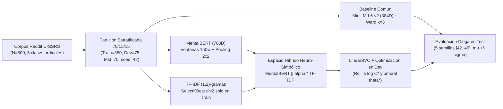

# text-classification-MD: Clasificación Supervisada de Riesgo Clínico en Texto (Reddit C-SSRS)

[](https://www.python.org/)
[](https://scikit-learn.org/)
[](https://huggingface.co/mental/mental-bert-base-uncased)
[](https://www.ehu.eus/)

> **Proyecto de Minería de Datos / Aprendizaje Supervisado (UPV/EHU)**  
> Clasificación supervisada multiclase desbalanceada sobre historiales clínicos longitudinales de Reddit (**Corpus C-SSRS**, $N = 500$ usuarios), combinando agregación temporal jerárquica en **MentalBERT** (768D), enriquecimiento léxico neuro-simbólico ($\text{TF-IDF} + \chi^2$) y **Support Vector Machines (SVM)** sin fuga de datos.

---

## 📋 Tabla de Contenidos
1. [Descripción General](#-descripción-general)
2. [Arquitectura del Pipeline](#-arquitectura-del-pipeline)
3. [Estructura del Proyecto](#-estructura-del-proyecto)
4. [Fundamentos Teóricos y Preguntas de Investigación](#-fundamentos-teóricos-y-preguntas-de-investigación)
5. [Resultados Experimentales](#-resultados-experimentales)
6. [Instalación y Requisitos](#-instalación-y-requisitos)
7. [Guía de Ejecución](#-guía-de-ejecución)
8. [Referencias Bibliográficas](#-referencias-bibliográficas)

---

## 🔬 Descripción General

La detección automática del riesgo de suicidio sobre historiales de publicaciones en redes sociales presenta dos retos principales: la **dilución de señales agudas** en historiales extensos (cuando un usuario publica decenas de mensajes cotidianos y una sola crisis crítica) y el **desbalanceo severo** de la clase de mayor riesgo (`Attempt`, $9.0\%$).

Este proyecto implementa un marco experimental reproducible y comparable sobre la partición común estratificada del equipo ($70\%$ Train / $15\%$ Dev / $15\%$ Test, `seed=42`):
* **Baseline común:** Embeddings `all-MiniLM-L6-v2` ($384\text{D}$) con Clustering Jerárquico Aglomerativo (`Ward`, $k=5$, determinista con $\sigma = 0.000$ sobre una partición).
* **Extractor Jerárquico MentalBERT:** Cobertura del $100\%$ de tokens mediante ventanas deslizantes ($150$ palabras, solapamiento $25$) y agregación factorial $2\times2$ (`Mean/Max` Intra-Post $\times$ Inter-Post) frente al truncamiento estándar a $512$ tokens.
* **Arquitectura Híbrida Neuro-Simbólica:** Concatenación inductiva de representaciones densas de MentalBERT con $K=100$ términos críticos seleccionados mediante $\chi^2$ exclusivamente en Train.
* **Protocolo estricto Anti-Data Leakage:** Vectorizador TF-IDF, selección $\chi^2$, normalización $\ell_2$, reducción SVD (RBF), ratio de coste asimétrico $r^*$, regularización $C^*$ (rejilla logarítmica base 10 en Dev) y calibración de umbral $\theta^*$ en Dev mantienen el conjunto **Test completamente ciego** hasta la evaluación final.

---

## 🏗️ Arquitectura del Pipeline



---

## 📁 Estructura del Proyecto

```text
text-classification-MD/
│
├── data/                                 # Datos crudos (excluidos de Git por NDA)
│   ├── .gitkeep
│   ├── 500_Reddit_users_posts_labels.csv # Dataset clínico C-SSRS (colocar aquí)
│   └── embeddings_384d_comun.npy         # Caché de embeddings MiniLM-L6-v2 (384D)
│
├── data_processed/                       # Artefactos generados en ejecución (excluidos de Git)
│   ├── .gitkeep
│   ├── embeddings_mentalbert_*.npy       # Cachés 768D (plano y 4 variantes jerárquicas)
│   ├── particiones_compartidas.json      # Índices de la partición oficial (seed=42)
│   ├── resultados_baseline.json          # Métricas y costes del baseline común
│   ├── resultados_rq1_pooling.json       # Resultados factoriales RQ1
│   ├── resultados_rq2_costes_pareto.json # Barrido de costes y comparativa RQ2
│   └── graficas_clasificacion/           # Figuras Seaborn a 300 DPI
│       ├── fig_rq1_pooling_bars.png
│       ├── fig_rq1_heatmap_2x2.png
│       ├── fig_rq2_pareto_frontier.png
│       └── fig_rq2_cost_gain_bars.png
│
├── src/                                  # Código fuente modular
│   ├── __init__.py
│   ├── config.py                         # Rutas reproducibles y ontología ordinal C-SSRS
│   ├── modulo_comun_equipo.py            # Partición oficial 70/15/15 y Baseline Ward 384D
│   ├── extraccion_mentalbert.py          # Extractor jerárquico en 2 niveles (MentalBERT 768D)
│   ├── metricas_clasificacion.py         # Métricas clínicas, espacio híbrido, Dev tuning y profiling
│   ├── experimento_rq1.py                # Experimento RQ1 (pooling temporal) y figuras 300 DPI
│   ├── experimento_rq2.py                # Experimento RQ2 (costes asimétricos y modelo híbrido)
│   ├── experimento_mejoras.py            # Extensiones SVM (L2, RBF SVD-64, Ordinal, clustering)
│   └── experimento_svm_opt.py            # Ablación de regularización C, L2 y umbral theta*
│
├── main.py                               # Orquestador CLI principal y tabla maestra
├── pipeline.py                           # Carga reproducible y resumen estadístico del corpus
├── ejecutar_pipeline.ps1                 # Lanzador para Windows PowerShell
├── ejecutar_pipeline.bat                 # Lanzador para Windows CMD
├── ejecutar_pipeline.sh                  # Lanzador para Linux / macOS Bash
├── requirements.txt                      # Dependencias del entorno Python
├── INFORME_CIENTIFICO_C-SSRS.md          # Memoria experimental y formalización completa
├── .gitignore                            # Exclusión de datos confidenciales y binarios
└── README.md                             # Documentación técnica del repositorio
```

---

## 🧠 Fundamentos Teóricos y Preguntas de Investigación

### Corpus y Ontología Clínica C-SSRS (Gaur et al., 2019)
* **5 niveles ordinales ($N=500$):** `Supportive` ($108$, $21.6\%$) $<$ `Indicator` ($99$, $19.8\%$) $<$ `Ideation` ($171$, $34.2\%$) $<$ `Behavior` ($77$, $15.4\%$) $<$ `Attempt` ($45$, $9.0\%$).
* **Partición común (`random_state=42`):** Train ($n=350$, $31$ `Attempt`), Dev ($n=75$, $7$ `Attempt`), Test ($n=75$, $7$ `Attempt`).

### RQ1 — Agregación Temporal Jerárquica vs. Truncamiento a 512 Tokens
> *«¿Cómo afecta la función de agregación temporal del historial de usuario (`Mean-Pooling` truncado a 512 tokens frente a agregación jerárquica en dos niveles `Mean/Max`) a la detección de publicaciones aisladas de crisis aguda (`Attempt`) con SVM?»*

* `Plano Truncado (512)` alcanza `F1-Attempt` $= 0.462$ en `seed=42`, pero colapsa a $0.000$ en 3 de 5 particiones ($\sigma = 0.182$).
* `Jerárquico Mean-Mean` obtiene la mayor estabilidad global (`Macro-F1` $= 0.327 \pm 0.035$, `F1-Attempt` $= 0.196 \pm 0.119$, `Precision` $= 0.407$), mientras `Max-Mean` maximiza `Quadratic Kappa` ($0.344 \pm 0.101$). No obstante, con pérdida simétrica ($C=1.0$), el `Recall-Attempt` queda por debajo de $0.15$.

### RQ2 — Penalización Asimétrica de Costes vs. Modelo Híbrido Neuro-Simbólico
> *«¿Qué mecanismo mitiga mejor el colapso del Recall al $9\%$ de prevalencia: la reponderación asimétrica de costes ($r = C_{\text{FN}} / C_{\text{FP}}$) o la combinación neuro-simbólica ($\text{MentalBERT} + \text{TF-IDF}_{\chi^2}$) calibrada en Dev?»*

* El barrido $r \in [1.0, 20.0]$ sobre `Mean-Mean` ($r^* = 2.0$ en Dev) estanca el `Recall-Attempt` en $0.171 \pm 0.107$ mientras la precisión desciende de $0.407$ a $0.082$.
* La arquitectura híbrida neuro-simbólica ($\mathbf{x}_i = [\mathbf{e}_i^{\text{MentalBERT}} \parallel \alpha \cdot \mathbf{v}_i^{\text{TF-IDF}}]$) eleva `F1-Attempt` en `seed=42` a **`0.600`** (`Híbrido Oficial`), alcanza **`Quadratic Kappa = 0.442 ± 0.117`** con menor varianza en `Attempt` (`Híbrido Robusto`, $\sigma = 0.058$) y logra **`F1-Attempt = 0.225 ± 0.202`** con calibración de umbral en Dev (`Híbrido Triaje`).

---

## 📊 Resultados Experimentales

Evaluación ciega sobre Test ($n=75$) en la semilla oficial (`seed=42`) y estabilidad en 5 particiones estratificadas (`[42, 43, 44, 45, 46]`):

| Alternativa | Acc (s42) | Acc ($\mu \pm \sigma$) | w-F1 ($\mu$) | Macro-F1 ($\mu$) | F1-Att (s42) | F1-Att ($\mu \pm \sigma$) | $\kappa_w$ ($\mu$) | Latencia (ms/doc) |
| :--- | :---: | :---: | :---: | :---: | :---: | :---: | :---: | :---: |
| **1. Baseline (`MiniLM + Ward k=5`)** | $0.333$ | $0.299 \pm 0.023$ | $0.182$ | $0.118$ | $0.000$ | $0.000 \pm 0.000$ | $0.001$ | $0.009$ |
| **2. MentalBERT Plano (512)** | $0.347$ | $0.339 \pm 0.027$ | $0.327$ | $0.287$ | $0.462$ | $0.132 \pm 0.182$ | $0.328$ | $0.021$ |
| **2b. MentalBERT Jerárquico Mean-Mean** | $0.280$ | $0.355 \pm 0.048$ | $0.349$ | **0.327** | $0.364$ | $0.196 \pm 0.119$ | $0.341$ | $0.020$ |
| **3. Solo TF-IDF Crítico $\chi^2$ (`balanced`)** | $0.347$ | $0.336 \pm 0.010$ | $0.176$ | $0.119$ | $0.222$ | $0.094 \pm 0.116$ | $0.034$ | $0.014$ |
| **4a. Híbrido Oficial ($C=1.0$, simétrico)** | **0.347** | $0.352 \pm 0.025$ | $0.340$ | $0.305$ | **0.600** | $0.201 \pm 0.219$ | $0.349$ | $0.017$ |
| **4b. Híbrido Robusto ($\ell_2, C^*$ Dev, `balanced`)** | $0.307$ | **0.371 ± 0.048** | **0.350** | $0.319$ | $0.125$ | $0.214 \pm \mathbf{0.058}$ | **0.442** | $0.022$ |
| **4c. Híbrido Triaje Dev ($\theta^*$ calibrado)** | **0.347** | $0.339 \pm 0.031$ | $0.333$ | $0.302$ | **0.600** | **0.225 ± 0.202** | $0.347$ | $0.017$ |

Para las tablas completas por clase (`Supportive`..`Attempt`), curvas ROC/PR-AUC y ablaciones (`SVC RBF`, `SVM Ordinal Frank & Hall`, `Ward 384D`), consultar [`INFORME_CIENTIFICO_C-SSRS.md`](./INFORME_CIENTIFICO_C-SSRS.md).

---

## 💻 Instalación y Requisitos

### Requisitos Previos
* Python 3.10 o superior (verificado en Python 3.13).
* Colocar el corpus `500_Reddit_users_posts_labels.csv` dentro de la carpeta `data/`.

### Pasos de Instalación

1. Clonar el repositorio:
   ```bash
   git clone https://github.com/aimarlarriba/text-classification-MD.git
   cd text-classification-MD
   ```

2. Crear y activar un entorno virtual:
   * **Windows (PowerShell):**
     ```powershell
     python -m venv .venv
     .\.venv\Scripts\Activate.ps1
     ```
   * **Linux / macOS:**
     ```bash
     python3 -m venv .venv
     source .venv/bin/activate
     ```

3. Instalar las dependencias:
   ```bash
   pip install -r requirements.txt
   ```

---

## 🚀 Guía de Ejecución

### Opción 1: Pipeline Completo con `main.py`
Ejecuta Baseline + RQ1 + RQ2 + Tabla Maestra y exporta resultados JSON y figuras a 300 DPI en `data_processed/`:
```bash
python main.py
```

### Opción 2: Lanzadores por Sistema Operativo
* **Windows (PowerShell):** `.\ejecutar_pipeline.ps1`
* **Windows (CMD):** `ejecutar_pipeline.bat`
* **Linux / macOS:** `chmod +x ejecutar_pipeline.sh && ./ejecutar_pipeline.sh`

### Opción 3: Ejecución Modular
```bash
python pipeline.py              # Resumen estadístico del corpus C-SSRS
python main.py --baseline       # Solo Baseline común (MiniLM 384D + Ward k=5)
python main.py --rq1            # Solo Experimento RQ1 (pooling temporal)
python main.py --rq2            # Solo Experimento RQ2 (costes y modelo híbrido)
python main.py --mejoras        # Extensiones SVM (RBF, Ordinal Frank & Hall, L2, clustering)
python main.py --svm-opt        # Ablación de regularización C, L2 y umbral theta*
```

---

## 📚 Referencias Bibliográficas

1. **Gaur, M., Alambo, A., Sain, J. P., Kursuncu, U., Thirunarayan, K., Kavuluru, R., Sheth, A., Welton, R., & Pathak, J. (2019).** *Knowledge-aware assessment of severity of suicide risk for early intervention.* WWW '19, pp. 514–525. ACM.
2. **Ji, S., Zhang, T., Ansari, L., Fu, J., Tiwari, P., & Cambria, E. (2021).** *MentalBERT: Publicly Available Pretrained Language Models for Mental Healthcare.* arXiv:2110.15621.
3. **Zirikly, A., Resnik, P., Uzuner, Ö., & Hollingshead, K. (2019).** *CLPsych 2019 shared task: Predicting the progression on Reddit to online suicidal risk.* CLPsych '19, pp. 24–33. NAACL.
4. **Matero, M., Soni, S., Choudhury, M. D., & Schwartz, H. A. (2021).** *Suicide risk assessment with hierarchical transformers on social media timelines.* EMNLP '21.
5. **Cortes, C., & Vapnik, V. (1995).** *Support-vector networks.* Machine Learning, 20(3), 273–297.
6. **Frank, E., & Hall, M. (2001).** *A simple approach to ordinal classification.* ECML '01, pp. 145–156. Springer.

---

Desarrollado por **[Aimar Larriba](https://github.com/aimarlarriba)** — Minería de Datos / Aprendizaje Supervisado (UPV/EHU).
