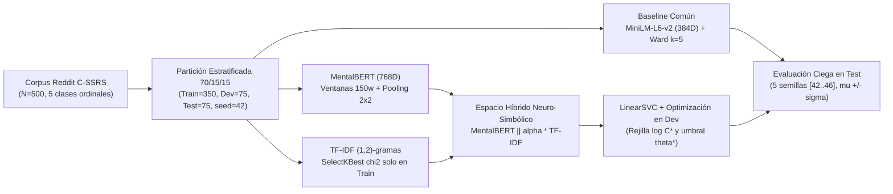

# Clasificación Supervisada de Riesgo Clínico en Texto (Reddit C-SSRS)


-1e3a8a)

Arquitectura experimental y pipeline reproducible para la clasificación supervisada multiclase del riesgo de suicidio sobre historiales longitudinales de Reddit (**Corpus C-SSRS**, Gaur et al., 2019), combinando representaciones jerárquicas de **MentalBERT** (Ji et al., 2021), selección léxica inductiva ($\text{TF-IDF} + \chi^2$) y **Support Vector Machines (SVM)**.

---

## Arquitectura del Pipeline



---

## Marco Experimental y Acuerdos del Equipo

* **Corpus ($N=500$):** `Ideation` ($171$, $34.2\%$), `Supportive` ($108$, $21.6\%$), `Indicator` ($99$, $19.8\%$), `Behavior` ($77$, $15.4\%$) y `Attempt` ($45$, $9.0\%$ — clase minoritaria crítica).
* **Partición común estratificada (`random_state=42`):** Train ($n=350$, $31$ `Attempt`), Dev ($n=75$, $7$ `Attempt`), Test ($n=75$, $7$ `Attempt`) mediante [`src/modulo_comun_equipo.py`](./src/modulo_comun_equipo.py).
* **Baseline compartido:** `all-MiniLM-L6-v2` ($384\text{D}$) + Clustering Jerárquico Aglomerativo (`Ward`, $k=5$, determinista con $\sigma = 0.000$ sobre una partición).
* **Control de Data Leakage:** Vectorizador TF-IDF, selector $\chi^2$, normalización $\ell_2$, reducción SVD (RBF), peso asimétrico $r^*$, regularización $C^*$ (rejilla logarítmica en Dev) y umbral $\theta^*$ se ajustan exclusivamente sobre Train/Dev; Test permanece congelado hasta la evaluación final.

---

## Preguntas de Investigación (Research Questions)

### RQ1 — Agregación Temporal Jerárquica vs. Truncamiento a 512 Tokens
> *«¿Cómo afecta la función de agregación temporal del historial de usuario (`Mean-Pooling` truncado a 512 tokens frente a agregación jerárquica en dos niveles `Mean/Max`) a la detección de publicaciones aisladas de crisis aguda (`Attempt`) con SVM?»*

* **Evidencia:** Bajo la partición fijada ($N=500$), `Plano Truncado (512)` alcanza `F1-Attempt` $= 0.462$ en `seed=42` pero colapsa a $0.000$ en 3 de 5 particiones ($\sigma = 0.182$). La estrategia `Jerárquico Mean-Mean` ofrece la mayor estabilidad inter-partición (`Macro-F1` $= 0.327 \pm 0.035$, `F1-Attempt` $= 0.196 \pm 0.119$, `Precision` $= 0.407$), mientras `Max-Mean` maximiza el acuerdo ordinal (`Quadratic Kappa` $= 0.344 \pm 0.101$). Bajo pérdida simétrica ($C=1.0$), el `Recall-Attempt` permanece por debajo de $0.15$.

### RQ2 — Penalización Asimétrica de Costes vs. Modelo Híbrido Neuro-Simbólico
> *«¿Qué mecanismo mitiga mejor el colapso del Recall al $9\%$ de prevalencia: la reponderación asimétrica de costes ($r = C_{\text{FN}} / C_{\text{FP}}$) o la combinación neuro-simbólica ($\text{MentalBERT} + \text{TF-IDF}_{\chi^2}$) calibrada en Dev?»*

* **Evidencia:** El barrido $r \in [1.0, 20.0]$ sobre `Mean-Mean` ($r^* = 2.0$ en Dev) estanca el `Recall-Attempt` en $0.171 \pm 0.107$ mientras degrada la precisión de $0.407$ a $0.082$. En contraste, la inyección léxica inductiva ($\chi^2$ en Train) eleva `F1-Attempt` en `seed=42` a **`0.600`** (`Híbrido Oficial`), maximiza el acuerdo ordinal hasta **`0.442 ± 0.117`** con menor varianza en `Attempt` (`Híbrido Robusto`, $\sigma = 0.058$) y alcanza **`0.225 ± 0.202`** de `F1-Attempt` medio mediante calibración de umbral en Dev (`Híbrido Triaje`).

---

## Resultados Principales en Test ($n=75$, 5 Semillas $[42..46]$)

| Alternativa | Acc (s42) | Acc ($\mu \pm \sigma$) | w-F1 ($\mu$) | Macro-F1 ($\mu$) | F1-Att (s42) | F1-Att ($\mu \pm \sigma$) | $\kappa_w$ ($\mu$) | Latencia (ms/doc) |
| :--- | :---: | :---: | :---: | :---: | :---: | :---: | :---: | :---: |
| **1. Baseline (`MiniLM + Ward k=5`)** | $0.333$ | $0.299 \pm 0.023$ | $0.182$ | $0.118$ | $0.000$ | $0.000 \pm 0.000$ | $0.001$ | $0.009$ |
| **2. MentalBERT Plano (512)** | $0.347$ | $0.339 \pm 0.027$ | $0.327$ | $0.287$ | $0.462$ | $0.132 \pm 0.182$ | $0.328$ | $0.021$ |
| **2b. MentalBERT Jerárquico Mean-Mean** | $0.280$ | $0.355 \pm 0.048$ | $0.349$ | **0.327** | $0.364$ | $0.196 \pm 0.119$ | $0.341$ | $0.020$ |
| **3. Solo TF-IDF Crítico $\chi^2$ (`balanced`)** | $0.347$ | $0.336 \pm 0.010$ | $0.176$ | $0.119$ | $0.222$ | $0.094 \pm 0.116$ | $0.034$ | $0.014$ |
| **4a. Híbrido Oficial ($C=1.0$, simétrico)** | **0.347** | $0.352 \pm 0.025$ | $0.340$ | $0.305$ | **0.600** | $0.201 \pm 0.219$ | $0.349$ | $0.017$ |
| **4b. Híbrido Robusto ($\ell_2, C^*$ Dev, `balanced`)** | $0.307$ | **0.371 ± 0.048** | **0.350** | $0.319$ | $0.125$ | $0.214 \pm \mathbf{0.058}$ | **0.442** | $0.022$ |
| **4c. Híbrido Triaje Dev ($\theta^*$ calibrado)** | **0.347** | $0.339 \pm 0.031$ | $0.333$ | $0.302$ | **0.600** | **0.225 ± 0.202** | $0.347$ | $0.017$ |

Para la formalización matemática completa, tablas por clase (`Supportive`..`Attempt`), curvas ROC/PR-AUC y ablaciones (`RBF`, `SVM Ordinal Frank & Hall`, `Ward 384D`), consultar [`INFORME_CIENTIFICO_C-SSRS.md`](./INFORME_CIENTIFICO_C-SSRS.md).

---

## Estructura del Repositorio

```text
text-classification-MD/
├── main.py                              # Orquestador CLI (Baseline, RQ1, RQ2, mejoras y tabla maestra)
├── pipeline.py                          # Carga reproducible 70/15/15 y distribución de clases C-SSRS
├── ejecutar_pipeline.{ps1,sh,bat}       # Scripts de ejecución para Windows, Linux y macOS
├── requirements.txt                     # Dependencias Python
├── INFORME_CIENTIFICO_C-SSRS.md         # Memoria experimental y análisis detallado
└── src/
    ├── __init__.py
    ├── config.py                        # Rutas reproducibles y ontología ordinal C-SSRS
    ├── modulo_comun_equipo.py           # Partición oficial 70/15/15 (seed=42) y Baseline Ward 384D
    ├── extraccion_mentalbert.py         # Extractor jerárquico en 2 niveles sobre MentalBERT (768D)
    ├── metricas_clasificacion.py        # Métricas clínicas, espacio híbrido inductivo, Dev tuning y profiling
    ├── experimento_rq1.py               # Experimento factorial RQ1 y figuras Seaborn (300 DPI)
    ├── experimento_rq2.py               # Barrido de costes, frontera de Pareto y comparativa RQ2
    ├── experimento_mejoras.py           # Extensiones SVM (L2, RBF con SVD-64, Ordinal Frank & Hall, clustering)
    └── experimento_svm_opt.py           # Ablación de regularización C, normalización L2 y umbral theta*
```

*(Por acuerdo de confidencialidad / NDA del corpus clínico, los directorios `data/` y `data_processed/` están excluidos del control de versiones en `.gitignore`.)*

---

## Instalación y Uso

```bash
# 1. Instalar dependencias
pip install -r requirements.txt

# 2. Colocar el corpus en data/500_Reddit_users_posts_labels.csv y ejecutar el pipeline completo
python main.py
```

Opciones individuales disponibles:

```bash
python pipeline.py              # Resumen estadístico del corpus
python main.py --baseline       # Evaluación del baseline común (MiniLM + Ward k=5)
python main.py --rq1            # Experimento RQ1 (agregación temporal en MentalBERT)
python main.py --rq2            # Experimento RQ2 (costes asimétricos y modelo híbrido)
python main.py --mejoras        # Comparativa extendida SVM (RBF, Ordinal, L2, clustering)
python main.py --svm-opt        # Ablación de hiperparámetros LinearSVC
```
