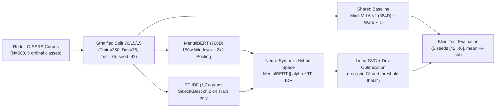

🌐 **Language / Idioma:** [English](README.md) • [Español](README.es.md)

# clinical-risk-nl: Supervised Clinical Risk Classification on Reddit (C-SSRS)

[](https://www.python.org/)
[](https://scikit-learn.org/)
[](https://huggingface.co/mental/mental-bert-base-uncased)
[](https://www.ehu.eus/)

> **Data Mining / Supervised Learning Project (UPV/EHU)**  
> Multi-class imbalanced supervised text classification on longitudinal Reddit mental health timelines (**C-SSRS Corpus**, $N = 500$ users), combining 2-level hierarchical pooling on **MentalBERT** (768D), inductive neuro-symbolic lexical anchoring ($\text{TF-IDF} + \chi^2$), and **Support Vector Machines (SVM)** with strict Train/Dev/Test separation.

---

## 📋 Table of Contents
1. [Overview](#-overview)
2. [Pipeline Architecture](#-pipeline-architecture)
3. [Project Structure](#-project-structure)
4. [Theoretical Background & Research Questions](#-theoretical-background--research-questions)
5. [Experimental Results](#-experimental-results)
6. [Installation & Requirements](#-installation--requirements)
7. [Quickstart CLI Guide](#-quickstart-cli-guide)
8. [References](#-references)

---

## 🔬 Overview

Automatic suicide risk assessment over social media user timelines poses two core challenges: **signal dilution** across long posting histories (where an acute crisis appears in an isolated post amid everyday messages) and **severe class imbalance** for the highest-risk category (`Attempt`, $9.0\%$).

This repository implements a reproducible experimental pipeline over the shared stratified team split ($70\%$ Train / $15\%$ Dev / $15\%$ Test, `seed=42`):
* **Shared Baseline:** `all-MiniLM-L6-v2` ($384\text{D}$) embeddings with Agglomerative Hierarchical Clustering (`Ward`, $k=5$, deterministic with $\sigma = 0.000$ on a fixed split).
* **Hierarchical MentalBERT Extractor:** $100\%$ token coverage via sliding windows ($150$ words, $25$-word overlap) and a $2\times2$ factorial pooling grid (`Mean/Max` Intra-Post $\times$ Inter-Post) compared against standard $512$-token truncation.
* **Neuro-Symbolic Hybrid Architecture:** Inductive concatenation of dense MentalBERT representations with $K=100$ critical unigrams/bigrams selected via $\chi^2$ strictly on Train.
* **Zero Data Leakage Protocol:** TF-IDF vectorizer, $\chi^2$ selector, $\ell_2$ normalization, SVD reduction (RBF), asymmetric cost ratio $r^*$, log-scale regularization $C^*$, and decision threshold $\theta^*$ are fitted/selected exclusively on Train/Dev; **Test remains blind** until final evaluation.

---

## 🏗️ Pipeline Architecture



---

## 📁 Project Structure

```text
clinical-risk-nl/
│
├── data/                                 # Raw data (excluded from Git under NDA)
│   ├── .gitkeep
│   ├── 500_Reddit_users_posts_labels.csv # C-SSRS clinical dataset (place here)
│   └── embeddings_384d_comun.npy         # Shared MiniLM-L6-v2 (384D) cache
│
├── data_processed/                       # Generated artifacts (excluded from Git)
│   ├── .gitkeep
│   ├── embeddings_mentalbert_*.npy       # 768D caches (flat + 4 hierarchical variants)
│   ├── particiones_compartidas.json      # Official split indices (seed=42)
│   ├── resultados_baseline.json          # Shared baseline metrics & profiling
│   ├── resultados_rq1_pooling.json       # RQ1 factorial pooling results
│   ├── resultados_rq2_costes_pareto.json # RQ2 cost sweep & model comparison
│   └── graficas_clasificacion/           # 300 DPI Seaborn figures
│       ├── fig_rq1_pooling_bars.png
│       ├── fig_rq1_heatmap_2x2.png
│       ├── fig_rq2_pareto_frontier.png
│       └── fig_rq2_cost_gain_bars.png
│
├── src/                                  # Modular source code
│   ├── __init__.py
│   ├── config.py                         # Reproducible paths and C-SSRS ordinal map
│   ├── modulo_comun_equipo.py            # Shared 70/15/15 split and Ward 384D baseline
│   ├── extraccion_mentalbert.py          # 2-level hierarchical MentalBERT extractor (768D)
│   ├── metricas_clasificacion.py         # Clinical metrics, hybrid space, Dev tuning & profiling
│   ├── experimento_rq1.py                # RQ1 pooling experiment & 300 DPI plots
│   ├── experimento_rq2.py                # RQ2 cost asymmetry & hybrid model comparison
│   ├── experimento_mejoras.py            # SVM extensions (L2, RBF SVD-64, Ordinal, clustering)
│   └── experimento_svm_opt.py            # Regularization C, L2 & threshold ablation study
│
├── main.py                               # Main CLI orchestrator & master comparison table
├── pipeline.py                           # Reproducible data loader & class distribution summary
├── ejecutar_pipeline.ps1                 # Windows PowerShell launcher
├── ejecutar_pipeline.bat                 # Windows CMD launcher
├── ejecutar_pipeline.sh                  # Linux / macOS Bash launcher
├── requirements.txt                      # Python dependencies
├── INFORME_CIENTIFICO_C-SSRS.md          # Full experimental report (Spanish)
├── .gitignore                            # Confidentiality & binary exclusions
├── README.md                             # English documentation
└── README.es.md                          # Spanish documentation
```

---

## 🧠 Theoretical Background & Research Questions

### Corpus & C-SSRS Clinical Ontology (Gaur et al., 2019)
* **5 ordinal severity levels ($N=500$):** `Supportive` ($108$, $21.6\%$) $<$ `Indicator` ($99$, $19.8\%$) $<$ `Ideation` ($171$, $34.2\%$) $<$ `Behavior` ($77$, $15.4\%$) $<$ `Attempt` ($45$, $9.0\%$).
* **Shared split (`random_state=42`):** Train ($n=350$, $31$ `Attempt`), Dev ($n=75$, $7$ `Attempt`), Test ($n=75$, $7$ `Attempt`).

### RQ1 — Hierarchical Temporal Aggregation vs. 512-Token Truncation
> *"How does temporal aggregation of user history (512-token truncated `Mean-Pooling` vs. 2-level hierarchical `Mean/Max` pooling) affect an SVM classifier's ability to detect isolated acute crisis posts (`Attempt`)?"*

* `Plano Truncado (512)` reaches `F1-Attempt` $= 0.462$ on `seed=42`, but collapses to $0.000$ in 3 out of 5 splits ($\sigma = 0.182$).
* `Hierarchical Mean-Mean` achieves the highest cross-split stability (`Macro-F1` $= 0.327 \pm 0.035$, `F1-Attempt` $= 0.196 \pm 0.119$, `Precision` $= 0.407$), while `Max-Mean` maximizes `Quadratic Weighted Kappa` ($0.344 \pm 0.101$). Under symmetric loss ($C=1.0$), `Recall-Attempt` remains below $0.15$.

### RQ2 — Asymmetric Cost Reweighting vs. Neuro-Symbolic Hybrid Model
> *"Which supervised mechanism better mitigates Recall collapse under $9\%$ prevalence: linear cost asymmetry ($r = C_{\text{FN}} / C_{\text{FP}}$) or a neuro-symbolic hybrid space ($\text{MentalBERT} + \text{TF-IDF}_{\chi^2}$) calibrated on Dev?"*

* Sweeping $r \in [1.0, 20.0]$ on `Mean-Mean` ($r^* = 2.0$ on Dev) saturates `Recall-Attempt` at $0.171 \pm 0.107$ while precision drops from $0.407$ to $0.082$.
* The neuro-symbolic hybrid ($\mathbf{x}_i = [\mathbf{e}_i^{\text{MentalBERT}} \parallel \alpha \cdot \mathbf{v}_i^{\text{TF-IDF}}]$) raises `F1-Attempt` on `seed=42` to **`0.600`** (`Híbrido Oficial`), reaches **`Quadratic Kappa = 0.442 ± 0.117`** with reduced `Attempt` variance (`Híbrido Robusto`, $\sigma = 0.058$), and yields **`F1-Attempt = 0.225 ± 0.202`** via Dev threshold calibration (`Híbrido Triaje`).

---

## 📊 Experimental Results

Blind Test evaluation ($n=75$) on the official split (`seed=42`) and stability across 5 stratified splits (`[42, 43, 44, 45, 46]`):

| Alternative | Acc (s42) | Acc ($\mu \pm \sigma$) | w-F1 ($\mu$) | Macro-F1 ($\mu$) | F1-Att (s42) | F1-Att ($\mu \pm \sigma$) | $\kappa_w$ ($\mu$) | Latency (ms/doc) |
| :--- | :---: | :---: | :---: | :---: | :---: | :---: | :---: | :---: |
| **1. Baseline (`MiniLM + Ward k=5`)** | $0.333$ | $0.299 \pm 0.023$ | $0.182$ | $0.118$ | $0.000$ | $0.000 \pm 0.000$ | $0.001$ | $0.009$ |
| **2. MentalBERT Flat (512)** | $0.347$ | $0.339 \pm 0.027$ | $0.327$ | $0.287$ | $0.462$ | $0.132 \pm 0.182$ | $0.328$ | $0.021$ |
| **2b. MentalBERT Hierarchical Mean-Mean** | $0.280$ | $0.355 \pm 0.048$ | $0.349$ | **0.327** | $0.364$ | $0.196 \pm 0.119$ | $0.341$ | $0.020$ |
| **3. TF-IDF Critical $\chi^2$ Only (`balanced`)** | $0.347$ | $0.336 \pm 0.010$ | $0.176$ | $0.119$ | $0.222$ | $0.094 \pm 0.116$ | $0.034$ | $0.014$ |
| **4a. Hybrid Official ($C=1.0$, symmetric)** | **0.347** | $0.352 \pm 0.025$ | $0.340$ | $0.305$ | **0.600** | $0.201 \pm 0.219$ | $0.349$ | $0.017$ |
| **4b. Hybrid Robust ($\ell_2, C^*$ Dev, `balanced`)** | $0.307$ | **0.371 ± 0.048** | **0.350** | $0.319$ | $0.125$ | $0.214 \pm \mathbf{0.058}$ | **0.442** | $0.022$ |
| **4c. Hybrid Triage Dev ($\theta^*$ calibrated)** | **0.347** | $0.339 \pm 0.031$ | $0.333$ | $0.302$ | **0.600** | **0.225 ± 0.202** | $0.347$ | $0.017$ |

See [`INFORME_CIENTIFICO_C-SSRS.md`](./INFORME_CIENTIFICO_C-SSRS.md) for per-class F1 tables (`Supportive`..`Attempt`), ROC/PR-AUC scores, and ablations (`SVC RBF`, `Frank & Hall Ordinal SVM`, `Ward 384D`).

---

## 💻 Installation & Requirements

### Prerequisites
* Python 3.10+ (tested on Python 3.13).
* Place `500_Reddit_users_posts_labels.csv` inside `data/`.

### Setup Steps

1. Clone the repository:
   ```bash
   git clone https://github.com/aimarlarriba/clinical-risk-nl.git
   cd clinical-risk-nl
   ```

2. Create and activate a virtual environment:
   * **Windows (PowerShell):**
     ```powershell
     python -m venv .venv
     .\.venv\Scripts\Activate.ps1
     ```
   * **Linux / macOS:**
     ```bash
     python3 -m venv .venv
     source .venv/bin/activate
     ```

3. Install dependencies:
   ```bash
   pip install -r requirements.txt
   ```

---

## 🚀 Quickstart CLI Guide

### Option 1: Full Pipeline via `main.py`
Runs Baseline + RQ1 + RQ2 + Master Table and exports JSON results and 300 DPI figures to `data_processed/`:
```bash
python main.py
```

### Option 2: OS Launchers
* **Windows (PowerShell):** `.\ejecutar_pipeline.ps1`
* **Windows (CMD):** `ejecutar_pipeline.bat`
* **Linux / macOS:** `chmod +x ejecutar_pipeline.sh && ./ejecutar_pipeline.sh`

### Option 3: Individual Modules
```bash
python pipeline.py              # Corpus C-SSRS class distribution summary
python main.py --baseline       # Shared baseline only (MiniLM 384D + Ward k=5)
python main.py --rq1            # RQ1 experiment only (temporal pooling)
python main.py --rq2            # RQ2 experiment only (cost asymmetry & hybrid model)
python main.py --mejoras        # SVM extensions (RBF, Frank & Hall Ordinal, L2, clustering)
python main.py --svm-opt        # LinearSVC regularization C, L2 & threshold ablation
```

---

## 📚 References

1. **Gaur, M., Alambo, A., Sain, J. P., Kursuncu, U., Thirunarayan, K., Kavuluru, R., Sheth, A., Welton, R., & Pathak, J. (2019).** *Knowledge-aware assessment of severity of suicide risk for early intervention.* WWW '19, pp. 514–525. ACM.
2. **Ji, S., Zhang, T., Ansari, L., Fu, J., Tiwari, P., & Cambria, E. (2021).** *MentalBERT: Publicly Available Pretrained Language Models for Mental Healthcare.* arXiv:2110.15621.
3. **Zirikly, A., Resnik, P., Uzuner, Ö., & Hollingshead, K. (2019).** *CLPsych 2019 shared task: Predicting the progression on Reddit to online suicidal risk.* CLPsych '19, pp. 24–33. NAACL.
4. **Matero, M., Soni, S., Choudhury, M. D., & Schwartz, H. A. (2021).** *Suicide risk assessment with hierarchical transformers on social media timelines.* EMNLP '21.
5. **Cortes, C., & Vapnik, V. (1995).** *Support-vector networks.* Machine Learning, 20(3), 273–297.
6. **Frank, E., & Hall, M. (2001).** *A simple approach to ordinal classification.* ECML '01, pp. 145–156. Springer.

---

Developed by **[Aimar Larriba](https://github.com/aimarlarriba)** — Data Mining / Supervised Learning (UPV/EHU).
